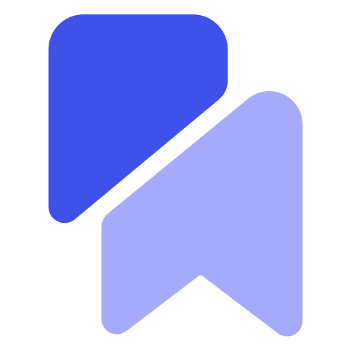
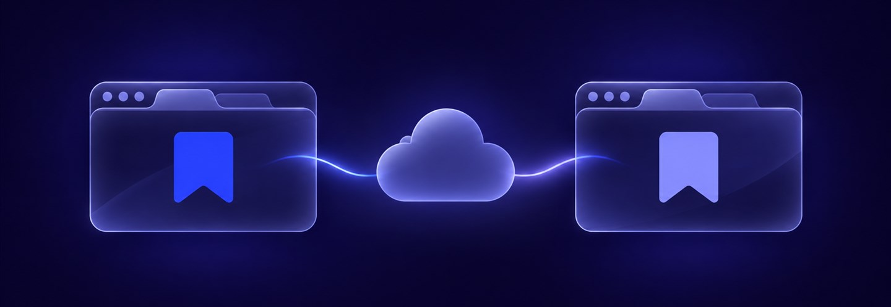
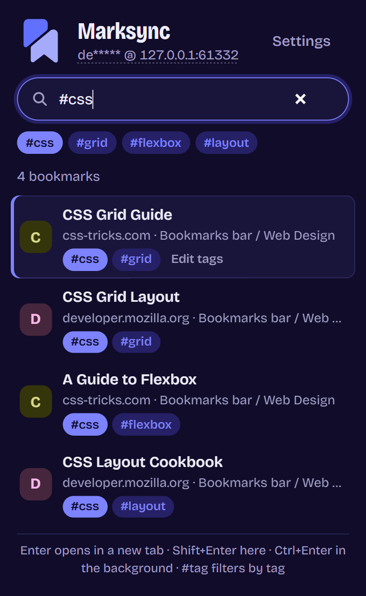
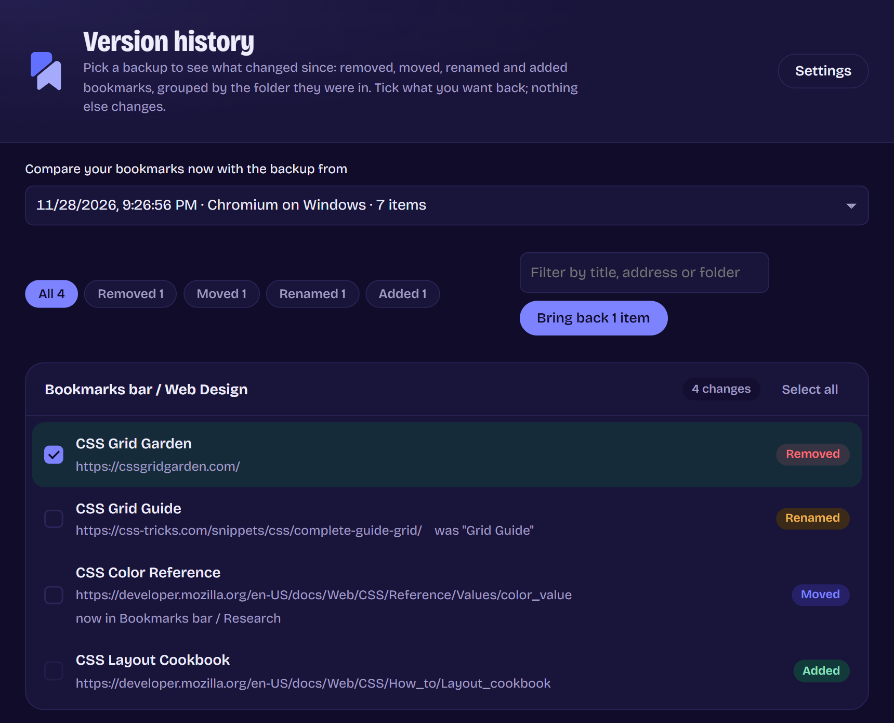

# Marksync

[](https://github.com/musayazlik/marksync/actions/workflows/ci.yml)
[](https://github.com/musayazlik/marksync/releases)

Open-source bookmark sync for **Chrome, Brave, Edge and Firefox**, with
backups in **your own Google Drive**.

Add a bookmark in Brave, open Firefox, and it is there, in the same folder
and position. No account on a third-party server: everything is stored in a
`Marksync` folder in your Google Drive, and the extension cannot see any
other file there.

[Türkçe](README.tr.md)



## Screenshots

### Search bookmarks by tag

Open Marksync from the browser toolbar and type `#css` to find bookmarks with that tag.



### Review changes and restore a bookmark

In **Settings**, open **History** next to the backup you want to compare. Select the bookmarks you want to restore, then click **Bring back**.



## Features

- Two-way sync between Chromium browsers and Firefox, on any number of computers
- Bookmarks bar, Other bookmarks, Mobile and Firefox's Bookmarks Menu mapped between browsers
- Conflict handling per field: a rename in one browser and a move in another both survive
- No duplicates when you connect a browser that already has the same bookmarks
- Safety stop when a sync would delete most of your bookmarks
- Automatic and manual backups in Google Drive, restore with one click
- Shared folders with family or a team: one folder synced with other Google accounts through its own Drive file; editors and viewers follow Drive's permissions
- Your own server instead of Google Drive: any WebDAV server (Nextcloud, ownCloud, a NAS) holds the same files, with the same encryption and conflict-safe writes
- Your bookmarks on any phone: a read-only web app (installable, works on iOS Safari and Android) that reads your Drive directly, with search, tags and encryption support ([viewer/](viewer/))
- AI assistants: the `marksync-mcp` server lets Claude, Cursor and other MCP clients search your bookmarks and propose changes you approve in Marksync ([mcp/](mcp/))
- Search by meaning: find bookmarks by what they are about, even when no word matches (opt-in, embeddings on OpenRouter or your own server, index shared through Drive)
- Rediscover: once a day or a week, the popup brings back a few bookmarks you forgot (some related to what you saved lately) to open, keep, archive or delete; off by default, nothing leaves the browser
- Tags, synced between browsers: AI sorting proposes them, you edit them in the popup, and `#tag` in the popup search filters by them
- Version history: compare any backup with your bookmarks now (removed, moved, renamed, added, grouped by folder), bring back a single bookmark or folder, and find the backup that still had a bookmark
- Import from another browser (with Marksync, or from any browser's HTML export), merged without duplicates or into a new folder
- Export to a standard HTML bookmarks file
- Interface in English and Turkish; a badge on the toolbar icon when sync needs you
- Duplicate finder: pages bookmarked more than once (even with http/https, a trailing slash or `utm_` parameters as the only difference); keep one copy, with a backup taken first
- Link checker: finds bookmarks whose pages are gone or have moved; update a moved bookmark to its new address, or point a dead one to its saved copy in the [Wayback Machine](https://web.archive.org)
- Optional AI sorting with your own [OpenRouter](https://openrouter.ai) key: pick an inbox folder, and the model (Claude Opus by default) researches each bookmark you add to it, moves it to the folder that fits best and explains what the site is and what it is used for; every decision is listed on a log page with Undo
- Free, private AI sorting without OpenRouter: point it at your own OpenAI-compatible server (Ollama, LM Studio, vLLM, llama.cpp) or use the browser's built-in on-device model (Chrome 138+, Gemini Nano)
- Name bookmarks with AI: pick folders, and the AI reads each page and proposes a clear title saying what the site is for; edit any proposal before saving, undo any rename
- Tidy up the whole library with AI: merge folders that mean the same thing, rename unclear ones, clean cryptic titles and drop empty folders, with a cost estimate first, a reviewable plan, a backup and Undo for every change
- AI extras: pick the model from OpenRouter's full list (search, free / web-research filters, prices), sort a whole existing folder with a review-and-approve preview, a monthly spending cap, and your OpenRouter balance and spending in the popup
- Instant search across all bookmarks from the popup (title, address, folder and what AI sorting learned about the site; ignores accents)
- Optional end-to-end encryption: the sync file, backups and browser lists in Drive are encrypted with a passphrase only you know (AES-256-GCM, PBKDF2)
- The account address is masked on screen (`mu*****7@gmail.com`) until you click it

## Stability

Marksync 1.0 is stable. From 1.0 on, versions follow [semantic versioning](https://semver.org):
a change that needs you to act (for example a new sync file format that older versions cannot
read) only comes with a new major version, and is called out in the release notes. Keep Marksync
up to date in every browser you sync.

## Supported browsers

| Browser | Install from | Notes |
|---|---|---|
| Chrome, Brave, Vivaldi, Arc, Yandex and other Chromium browsers | Chrome Web Store | Chrome signed in to Google: both the account and the "only on this device" bookmarks are synced |
| Microsoft Edge | Edge Add-ons, or Chrome Web Store | |
| Opera | Opera Add-ons, or Chrome Web Store | "Unsorted bookmarks" is synced as Other bookmarks; Trash and Speed Dial are not synced |
| Firefox, LibreWolf, Waterfox, Zen, Floorp (desktop) | Firefox Add-ons | Bookmarks Menu appears as a "Bookmarks Menu" folder in Chromium browsers |
| Safari | not possible | Safari extensions have no bookmarks API. Export an HTML file from Safari and import it in another browser |
| Mobile browsers | not possible | No extension bookmarks API on Android or iOS |

The sync rules are tested against simulated Chrome (with and without a Google
account), Opera and Firefox bookmark trees (`tests/`). Vivaldi and Arc have not
been tested yet; reports are welcome.

## How it works

See [docs/ARCHITECTURE.md](docs/ARCHITECTURE.md).

## Development

Requirements: Node.js 20+, pnpm.

```sh
pnpm install
cp .env.example .env      # add your Google OAuth client ID, see docs/GOOGLE_SETUP.md
pnpm dev                  # Chrome with hot reload
pnpm dev:firefox          # Firefox
pnpm test                 # unit and end-to-end sync tests
pnpm typecheck
pnpm build:dev            # development build to load unpacked (.output/chrome-mv3-dev)
pnpm build:all            # store builds; Firefox needs WXT_GECKO_ID set to an ID you own
pnpm zip:all              # store packages (+ sources zip for Firefox Add-ons)
```

Releases are automated: see [CONTRIBUTING.md](CONTRIBUTING.md#releases). Every version's
changes are in [CHANGELOG.md](CHANGELOG.md), and its store packages are attached to the
[GitHub release](https://github.com/musayazlik/marksync/releases).

Load the build manually:

- **Chrome / Brave / Edge**: `chrome://extensions` (or `brave://`, `edge://`) → Developer mode →
  *Load unpacked* → `.output/chrome-mv3-dev` (from `pnpm build:dev`)
- **Firefox**: `about:debugging#/runtime/this-firefox` → *Load Temporary Add-on* →
  `.output/firefox-mv3/manifest.json`

## Google sign-in

You need a Google Cloud project with the Drive API and an OAuth client of type
*Web application*. Step-by-step: [docs/GOOGLE_SETUP.md](docs/GOOGLE_SETUP.md).

## Privacy

- Requested Google scopes: `drive.file` (only files Marksync creates), `openid`, `email`.
- Bookmarks go straight from your browser to Google Drive; there is no Marksync server.
- Access tokens are kept in session storage and cleared when the browser closes.
- *Disconnect* unlinks only the browser you click it in; your other browsers stay connected.
  To remove Marksync's access everywhere, use https://myaccount.google.com/permissions.
- AI sorting is off by default. Only when you turn it on in a browser (which asks for permission
  to contact `openrouter.ai`, or the address of your own server), that browser sends the title and
  address (without the query string) of each bookmark you add to the inbox, plus your folder names,
  to that provider and the model you chose. With the browser's built-in model nothing leaves the
  device. API keys are kept in that browser's local storage and never uploaded to Drive.
- The link checker runs only when you start it (which asks for permission to open every site).
  It requests each bookmark's address without your cookies, never opens addresses on your own
  computer or local network, and looks up the address of each page that is gone at `archive.org`.
- With encryption on, Drive holds only encrypted file contents. File names, dates, browser names and
  bookmark counts (shown in the backup and import lists) stay readable. The passphrase never leaves
  your browsers; each browser keeps the derived key in its local storage until you disconnect.
  A forgotten passphrase cannot be recovered: *Forgot the passphrase* deletes the encrypted files
  and starts sync over from your bookmarks, which are never touched.

## Free, and staying free

Marksync has no server and no account of its own, and it stays that way:

- Everything is free. AI features run with your own key (OpenRouter), on your own server
  (Ollama, LM Studio, ...) or on the browser's built-in model, so Marksync never pays for your
  requests and never sees them.
- There are no paid tiers or "Pro" features, and no hosted AI proxy: it would need a server and
  break the promise that your data only goes between your browsers, your Drive and the AI provider
  you chose.
- If Marksync is useful to you, a star, a bug report, a translation or a pull request helps the
  most.

## Contributing

See [CONTRIBUTING.md](CONTRIBUTING.md). Licence: [MIT](LICENSE).
